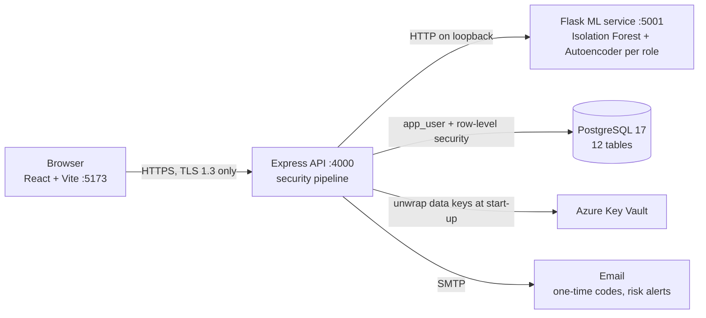

# ChildGuard — Child Data Security System

**Child Data Security System Using Encryption, Role-Based Access Control and
Machine Learning Anomaly Detection** — capstone project, BSc Informatics and
Computer Science, Strathmore University.

| | |
|---|---|
| **Author** | Faith Chelulei Cherop (163446) |
| **Stack** | React · Node.js/Express · PostgreSQL · Python/Flask · scikit-learn · TensorFlow/Keras |
| **Dataset** | CERT Insider Threat Dataset r4.2 (Carnegie Mellon University) |

---

## Contents

1. [Overview](#overview)
2. [Features by role](#features-by-role)
3. [Architecture](#architecture)
4. [How the three security layers work](#how-the-three-security-layers-work)
5. [Data protection features](#data-protection-features)
6. [Technology stack](#technology-stack)
7. [Repository layout](#repository-layout)
8. [Database](#database)
9. [API overview](#api-overview)
10. [Getting started](#getting-started)
11. [Running the system](#running-the-system)
12. [Configuration](#configuration)
13. [Testing](#testing)
14. [Machine learning pipeline](#machine-learning-pipeline)
15. [Encryption key management](#encryption-key-management)
16. [Project status](#project-status)
17. [Known limitations](#known-limitations)
18. [Documentation](#documentation)

---

## Overview

Early childhood development platforms hold sensitive data about children:
identity details, developmental milestones, health indicators and family
background. Encryption and role-based access control keep outsiders away
from that data, but they cannot tell when a user who already has valid
access starts misusing it.

ChildGuard protects child data with three layers that act together on
every request:

| Layer | What it does |
|---|---|
| **1. Encryption with data separation** | Identity details and developmental records are stored in separate tables, every value encrypted with AES-256-GCM. Data keys carry a key id for rotation and are wrapped by a master key in Azure Key Vault. |
| **2. Access control with consent enforcement** | A permission map on every route, PostgreSQL row-level security so a caregiver reaches only their own children, and a consent check before any record is released. |
| **3. Machine learning anomaly detection** | Every data action is scored by a per-role Isolation Forest + Autoencoder trained on CERT r4.2. A flagged action ends the session, emails the owner, and queues the session for the Security Auditor. |

All users sign in with a password **and** a one-time code sent by email.
Sensitive administrator actions also ask for the password again
(step-up authentication).

---

## Features by role

| Role | What they can do |
|---|---|
| **Caregiver** | Register a child (with privacy notice), view their own children, add and view developmental records, grant or withdraw consent per scope, correct a child's details, archive and restore a profile |
| **Security Auditor** | Review the queue of flagged sessions and mark each one, record breach decisions against a 72-hour window, search the audit log, download reports (audit log, flagged sessions, consent activity) as CSV or PDF |
| **System Administrator** | Approve or reject account requests, unlock locked accounts with a temporary password, view and rotate encryption keys, run the data-retention job |
| **Child** | A data subject only: linked to a caregiver, never signs in |

Accounts are never self-created: anyone can submit an access request
(Caregiver or Security Auditor), and a System Administrator approves it.

---

## Architecture



Every request to child data passes through the same pipeline in the
backend:

1. **Authenticate** — the token is checked, and so is its server-side
   session row, so a revoked session stops working at once.
2. **Password change** — a user still on a temporary password can do
   nothing else.
3. **Role permission** — the route's permission must be in the user's role.
4. **Input check** — ids in the URL must be numbers (anything else is 400).
5. **Ownership** — PostgreSQL row-level security only returns the
   caregiver's own children.
6. **Consent** — the consent scope must be granted before records are
   released.
7. **Action and audit** — the action runs (decrypting only what is
   needed), and an access request is recorded.
8. **Risk scoring** — the seven behaviour features are computed and sent
   to the ML service (5-second limit). At or above the role's threshold,
   the response starts (next section).

---

## How the three security layers work

### 1. Encryption with data separation

- `child_identifiers` (name, date of birth, family background) and
  `developmental_records` (milestone, health indicator, assessment score,
  notes) are separate tables linked only by a profile id.
- Each value is encrypted with **AES-256-GCM** and a fresh 12-byte IV.
  Stored format: `CGK` marker · key id · IV · ciphertext · auth tag.
- The key id makes **rotation** possible: old values stay readable, new
  values use the active key, and a re-encryption job moves everything
  over and verifies it.
- Data keys are **wrapped (RSA-OAEP-256) by a master key in Azure Key
  Vault** and unwrapped in memory at start-up. If the vault refuses, the
  backend does not start.

### 2. Access control with consent enforcement

- Permission map per role in `backend/src/middleware/rbac.js`, checked on
  every route.
- **Row-level security** (`backend/db/004_rls.sql`): deny by
  default; a caregiver sees and changes only rows of their own children,
  even if an application check were bypassed.
- **Consent** is opt-in per scope. The identity scope is required while
  the profile exists; developmental records need their own consent, and
  every grant and withdrawal is kept as history.
- The application connects as the restricted `app_user`, which may add
  and read audit entries but never change or delete them.

### 3. Anomaly detection and automatic response

- Actions on child data and privileged auditor/admin actions are scored
  for **all three roles**. Sign-ins and page lists are logged, not scored.
- If the combined score reaches the role's **deployment threshold**
  (Caregiver 0.40 · Security Auditor 0.65 · SysAdmin 0.60):
  1. the session is revoked and the next request is refused;
  2. an audit entry is written;
  3. the account owner gets an email with **This was me** and
     **This was NOT me** links;
  4. the session goes into the Security Auditor's review queue.
- **This was NOT me** locks the account until a System Administrator
  unlocks it with a new temporary password.
- If the ML service is down, actions still go through (fail-open) and are
  logged without a score.

---

## Data protection features

Built with the Kenya Data Protection Act 2019 in mind:

| Feature | How it works |
|---|---|
| Consent | Opt-in per scope, checked on every records request, full history kept |
| Correction | A caregiver can correct a child's details; each correction is audited (field name only, never the value) |
| Archive and restore | An archived profile is frozen by the database: no changes to it, its identity details or its records |
| Retention | Profiles archived longer than `RETENTION_DAYS` (default 365) have their identity overwritten; records, consent history and audit entries are kept |
| Privacy notice | The version accepted is stored with each account request and each child registration |
| Breach decisions | For escalated or "not me" sessions the auditor records, once and with a reason, whether the Data Commissioner was notified; the screen shows hours since the flag against 72 hours |
| Reports | Audit log, flagged sessions and consent activity as CSV or PDF; each download is logged and scored, at most `REPORT_EXPORTS_PER_HOUR` (default 10) per hour |

---

## Technology stack

| Part | Technology |
|---|---|
| Frontend | React 18, React Router, Vite, Tailwind CSS |
| Backend | Node.js (developed on v24), Express 4, `pg`, `bcryptjs`, `jsonwebtoken`, `helmet`, `express-rate-limit`, `nodemailer`, `pdfkit`, Azure Identity and Key Vault Keys SDKs |
| Database | PostgreSQL 17 with row-level security |
| ML service | Python 3.10+ (developed on 3.13), Flask, scikit-learn, TensorFlow/Keras, pandas, NumPy, joblib |
| Key store | Azure Key Vault (optional for local development) |

---

## Repository layout

```
ICS_PROJECT_2/
├── ml/
│   ├── data/                 CERT r4.2 files (raw logon/file/device CSVs are not in git)
│   ├── data/processed/       sessions_features.csv (~470k sessions, 7 features; release download)
│   ├── scripts/              01 preprocess → 02 train → 03 demo; 04–11 design diagnostics
│   ├── models/               per-role scaler, Isolation Forest, Autoencoder, metrics, charts
│   └── service/app.py        Flask scoring service (/score, /health)
├── backend/
│   ├── db/                   numbered SQL (001_schema.sql …), migrate.js, seed.js
│   ├── src/
│   │   ├── routes/           one file per area (auth, children, auditor, admin, …)
│   │   ├── controllers/      request handling
│   │   ├── services/         risk engine, feature computation, consent, retention, key rotation
│   │   ├── middleware/       auth, rbac, step-up, id validation
│   │   └── utils/            encryption, key vault, mailer, ML client, audit log
│   ├── scripts/              certificate, key, key-vault and retention tools
│   └── test/                 unit, API, performance, anomaly-injection, penetration tests
├── frontend/
│   └── src/pages/            login, register, caregiver/, auditor/, admin/
├── docs/RISK_THRESHOLDS.md   research vs. live thresholds and how they were calibrated
├── requirements.txt          pinned Python packages
└── README.md
```

---

## Database

Twelve tables in PostgreSQL:

| Group | Tables |
|---|---|
| Users and sign-in | `roles`, `users`, `mfa_codes`, `sessions`, `registration_requests` |
| Child data (encrypted, row-level security) | `child_profiles`, `child_identifiers`, `developmental_records`, `consent_records` |
| Monitoring | `access_requests`, `risk_scores`, `audit_log` |

---

## API overview

All routes are served over HTTPS on port 4000 and return JSON.

| Area | Method and path | Who |
|---|---|---|
| **Auth** | `POST /auth/login` · `POST /auth/verify-mfa` | Anyone (rate-limited) |
| | `POST /auth/logout` · `GET /auth/me` · `POST /auth/change-password` | Signed-in user |
| | `POST /auth/register` | Anyone (creates an access request) |
| **Children** | `GET /children` · `POST /children` | Caregiver |
| | `PATCH /children/:id` · `POST /children/:id/archive` · `POST /children/:id/restore` | Caregiver (own child) |
| | `GET /children/:id/records` · `POST /children/:id/records` | Caregiver (own child, consent required) |
| | `GET /children/:id/consent` · `POST /children/:id/consent` | Caregiver (own child) |
| **Auditor** | `GET /auditor/overview` · `GET /auditor/flagged-sessions` | Security Auditor |
| | `POST /auditor/flagged-sessions/:id/review` · `POST /auditor/flagged-sessions/:id/breach-decision` | Security Auditor |
| | `GET /auditor/audit-log` · `GET /auditor/reports/:report` | Security Auditor |
| **Admin** | `GET /admin/overview` · `GET /admin/registration-requests` | System Administrator |
| | `POST /admin/registration-requests/:id/approve` · `…/reject` | System Administrator |
| | `GET /admin/users/locked` · `POST /admin/users/:id/unlock` | System Administrator |
| | `GET /admin/encryption/status` · `POST /admin/encryption/reencrypt` 🔐 | System Administrator |
| | `GET /admin/retention/status` · `POST /admin/retention/apply` 🔐 | System Administrator |
| **Risk response** | `GET /risk-response/:id/confirm` · `GET /risk-response/:id/deny` | Signed email link |

🔐 = step-up authentication (password asked again).

---

## Getting started

### Prerequisites

- Python 3.10+ and Git
- Node.js (developed on v24)
- PostgreSQL 17
- Optional: Azure CLI (`az login`) if the data keys are wrapped in Azure Key Vault

### 1. Python environment

From the repo root:

```powershell
python -m venv .venv
.venv\Scripts\Activate.ps1
pip install -r requirements.txt
```

(`.venv\Scripts\activate.bat` on cmd, `source .venv/bin/activate` on Mac/Linux.)

### 2. Database

Create the database and the restricted account the backend connects as
(same commands on every system):

```
psql -U postgres -c "CREATE DATABASE ics_project_2;"
psql -U postgres -c "CREATE ROLE app_user LOGIN PASSWORD 'choose-a-password';"
```

The tables are created in step 3 by `db/migrate.js`, which applies the
numbered files in `backend/db/` (`001_schema.sql` to
`007_app_user_grants.sql`) in order, each once, and records them in
`schema_migrations`. A file that fails is rolled back and stops the run.
The last file gives `app_user` its rights: it can read and write the
application tables, but only add and read audit entries, never change or
delete them.

### 3. Backend

Windows (PowerShell):

```powershell
cd backend
npm install
copy .env.example .env      # then fill it in (see Configuration)
$env:MIGRATE_DATABASE_URL = "postgres://postgres:<postgres-password>@localhost:5432/ics_project_2"
node db/migrate.js          # create all tables, policies and rights
npm run cert:new            # local TLS certificate in backend/certs/ (gitignored)
npm run cert:trust          # trust it for your Windows user — click Yes
npm run key:new             # create a data encryption key
node db/seed.js             # one demo account per role
```

macOS / Linux:

```bash
cd backend
npm install
cp .env.example .env        # then fill it in (see Configuration)
export MIGRATE_DATABASE_URL="postgres://postgres:<postgres-password>@localhost:5432/ics_project_2"
node db/migrate.js
npm run cert:new
# trust the certificate: macOS
sudo security add-trusted-cert -d -r trustRoot -k /Library/Keychains/System.keychain certs/localhost-cert.pem
# or Ubuntu/Debian
sudo cp certs/localhost-cert.pem /usr/local/share/ca-certificates/childguard-localhost.crt && sudo update-ca-certificates
npm run key:new
node db/seed.js
```

`node db/seed.js` creates `demo.caregiver`, `demo.auditor` and
`demo.admin`. Their password is `DEMO_ACCOUNT_PASSWORD` and their emails
are built from `DEMO_EMAIL_BASE` (`you@example.com` gives
`you+caregiver@example.com` and so on), both from `.env`, so nothing
personal is stored in the code. Use an inbox you can read: sign-in codes
are emailed. Firefox keeps its own certificate store, so use Chrome or
Edge, or accept the certificate in Firefox manually.

A database set up before `migrate.js` existed is recognised the first
time it runs and recorded as up to date without changes.

### 4. Frontend

```powershell
cd frontend
npm install
```

---

## Running the system

Start the three services in this order, each in its own terminal:

| # | Service | Command (from the repo root) | Ready when you see |
|---|---|---|---|
| 1 | ML risk service (Flask, :5001) | `.venv\Scripts\python.exe ml\service\app.py` | `Running on http://127.0.0.1:5001` |
| 2 | Backend API (Express, :4000) | `cd backend` then `npm run dev` | `Backend listening on https://localhost:4000` |
| 3 | Frontend (React/Vite, :5173) | `cd frontend` then `npm run dev` | `Local: https://localhost:5173/` |

Then open **https://localhost:5173**. Browser ↔ backend traffic is HTTPS
with TLS 1.3 only; the backend → ML service hop stays plain HTTP on the
loopback address and never leaves the machine.

---

## Configuration

`backend/.env` (copied from `backend/.env.example`, never committed):

| Setting | Purpose |
|---|---|
| `PORT` | Backend port (4000) |
| `DATABASE_URL` | Connection string — must use the restricted `app_user` |
| `JWT_SECRET`, `JWT_EXPIRES_IN` | Signing secret and lifetime (1 h) of session tokens |
| `RISK_TOKEN_SECRET` | Optional: separate secret for the "This was me" email links (otherwise derived from `JWT_SECRET`, never equal to it) |
| `ENCRYPTION_KEY` / `ENCRYPTION_KEY_<n>` / `ENCRYPTION_KEY_<n>_WRAPPED` | Data encryption keys (plain for local development, wrapped when Key Vault is used) |
| `KEY_VAULT_URL`, `KEY_VAULT_KEY_NAME` | Azure Key Vault and the master key that wraps the data keys |
| `SMTP_HOST`, `SMTP_PORT`, `SMTP_USER`, `SMTP_PASS`, `SMTP_FROM` | Mail account for one-time codes and risk alerts |
| `APP_BASE_URL` | Base address used in the links of alert emails |
| `ML_SERVICE_URL` | Address of the Flask service (loopback) |
| `FRONTEND_ORIGIN` | The only origin allowed by CORS |
| `TLS_CERT_FILE`, `TLS_KEY_FILE` | Certificate files for HTTPS |
| `DEMO_ACCOUNT_PASSWORD` | Password for the seeded demo accounts |
| `DEMO_EMAIL_BASE` | Inbox the demo and test accounts are built from (`you+caregiver@…`) |
| `RETENTION_DAYS` | Days after archiving before a profile is anonymised (365) |
| `REPORT_EXPORTS_PER_HOUR` | Report downloads allowed per auditor per hour (10) |

---

## Testing

Run from `backend/`. Every test except `npm test` needs the three services
running.

| Command | What it checks | Latest result |
|---|---|---|
| `npm test` | Unit tests: encryption, Key Vault wrapping (with a stand-in vault), CSV/PDF report formats | 18 of 18 passed |
| `npm run test:api` | End-to-end API checks: roles, consent, row-level security, archiving, retention, reports, risk flagging, breach decisions. Uses dedicated test accounts and is non-destructive | 177 of 177 |
| `npm run test:perf` | Response time of access decisions against the < 1 second requirement | 7 of 7 scenarios under 1 s at the 95th percentile |
| `npm run test:anomaly` | Ten insider and normal-use scenarios acted out against the live system | 10 of 10 |
| `npm run test:pen` | Penetration-style attacks: fake identity, password guessing, privilege escalation, other families' data, consent bypass, injection, transport | 59 of 59 attacks refused |
| `npm run sim:traffic` | Two simulated weeks of caregiver, auditor and administrator traffic with scripted insiders, scored through the live feature code; calibrates thresholds and reports false sign-outs ([`docs/LIVE_SIMULATION.md`](docs/LIVE_SIMULATION.md)) | Caregiver 0.40: 4 of 4 insiders caught, 0.6 false sign-outs per user per week |
| `test\manual_test.ps1` | Interactive walk-through with real emailed one-time codes for all three roles | 18 passed, 0 failed |
| `test\full_flow_test.ps1` | Interactive end-to-end flow including a flagged session | — |

Results of the performance, anomaly and penetration tests are saved as
JSON in `backend/test/results/` (gitignored).

---

## Machine learning pipeline

**Data.** CERT Insider Threat Dataset r4.2: 1,000 synthetic employees over
17 months, 470,591 sessions, 1,831 labelled malicious. Departments are
mapped to roles: IT admins → SysAdmin, the security department →
Security Auditor, everyone else → Caregiver. Labels are used only to
evaluate, never to train.

**Features** (seven, chosen because the web app can compute them from its
own logs): `files_accessed_per_session`, `events_prev_day`,
`events_prev_hour`, `unique_pcs_used_that_day`, `session_duration_minutes`,
`is_after_hours`, `is_own_pc`.

**Models.** Per role: a `StandardScaler`, an Isolation Forest (200 trees)
and a 7-12-6-12-7 Autoencoder, trained on normal sessions only. The risk
score is the mean of the two normalised scores.

| Role | AUC | Precision | Recall | Research threshold | Live threshold |
|---|---|---|---|---|---|
| Caregiver | 0.769 | 0.052 | 0.608 | 0.11 | **0.40** |
| Security Auditor | 0.665 | 0.019 | 0.429 | 0.31 | **0.65** |
| System Administrator | 0.719 | 0.079 | 0.317 | 0.22 | **0.60** |

The research thresholds would sign out about one normal caregiver
session in five, so the live thresholds were calibrated on realistic app
sessions instead — see [`docs/RISK_THRESHOLDS.md`](docs/RISK_THRESHOLDS.md).

**Run it**

The processed sessions file (57 MB) is not in git. Download it from the
[`data-v1` release](https://github.com/FaithChelulei/ICS_PROJECT_2/releases/tag/data-v1)
into `ml/data/processed/`, or with the GitHub CLI:

```powershell
gh release download data-v1 -D ml\data\processed
```

(SHA-256 `62fafbe2050754870734018c3c84a025bba3ab3fd59e3745cfa715e5f3dfffa6`.)
The trained models are in git, so the website does not need this file;
only retraining and the evaluation scripts do.

```powershell
python ml\scripts\03_run_inference_demo.py   # score all sessions with the saved models (< 1 min)
python ml\scripts\02_train_models.py         # retrain all 6 models and overwrite ml\models\
```

`logon.csv`, `file.csv` and `device.csv` are not in git (`file.csv` alone
is ~193 MB) and are only needed to rerun `01_preprocess.py` from the raw
logs. Scripts `04`–`11` are diagnostics used for design decisions
(feature selection, threshold behaviour), not part of the main pipeline.

---

## Encryption key management

Run from `backend/`:

| Command | What it does |
|---|---|
| `npm run key:new` | Create a new data key and make it active (written wrapped when Key Vault is configured) |
| `npm run key:status` | Show the configured keys and which one is active |
| `npm run key:reencrypt` | Re-encrypt every value under the active key |
| `npm run key:verify` | Check that every stored value decrypts |
| `npm run key:wrap` | Move plain keys in `.env` under the Key Vault master key |
| `npm run key:check` | Prove this machine can unlock the wrapped keys |

With Key Vault configured, sign in with `az login` first, or the backend
refuses to start. Without `KEY_VAULT_URL` and `KEY_VAULT_KEY_NAME`, plain
keys in `.env` still work for local development. The same status and
re-encryption are available on the administrator's **Encryption Keys**
page.

---

## Project status

| Milestone | Status |
|---|---|
| ML anomaly detection pipeline | ✅ Done |
| RBAC and encryption layer | ✅ Done |
| System build (frontend, backend, auditor dashboard, audit log, risk response) | ✅ Done |
| Hardening: TLS 1.3, consent, row-level security, data protection features, Key Vault, step-up authentication, test suites | ✅ Done (PR #21) |
| Admin controls: change risk thresholds, user roles and system settings on screen | 🚧 In progress (issue #20) |

---

## Known limitations

- **Domain shift.** The models learnt from synthetic office workers, not
  caregivers. In simulated app traffic (`docs/LIVE_SIMULATION.md`), most
  false sign-outs come from caregivers using the app after 20:00 or on a
  second device, which the model reads as misuse. Real use should be
  measured before real child data is stored.
- **Evaluation protocol.** Research thresholds were chosen on the test
  set, and the test set's share of malicious sessions (1.8% for
  Caregivers) is higher than in the full data (0.37%), so the reported
  precision is optimistic.
- **Security Auditor role.** Only 7 malicious test sessions, so its
  results are not reliable.
- **Device name.** The device is identified from a request header, which
  a client can set.
- **Email links** confirm or deny on a simple link click.
- **Scope.** Tested on one machine with scripted scenarios; no study with
  real users and no legal review of the data protection features.

---

## Documentation

- [`docs/RISK_THRESHOLDS.md`](docs/RISK_THRESHOLDS.md) — research vs. live
  thresholds and their calibration
- [`docs/MODEL_EVALUATION_VALIDATED.md`](docs/MODEL_EVALUATION_VALIDATED.md) —
  stricter re-evaluation: unseen people, limits chosen on validation,
  synthetic attacks
- [`docs/DPIA.md`](docs/DPIA.md) — data protection impact assessment
  (Kenya Data Protection Act 2019) and threat model, with the gaps to
  close before real use
- [`docs/LIVE_SIMULATION.md`](docs/LIVE_SIMULATION.md) — simulated app traffic:
  how the models behave on this app's users, and threshold recommendations
- `backend/.env.example` — every setting, with comments
- Comments at the top of each source file explain the design decisions
  and the evidence behind them
- The project report (Chapters 1–6) is submitted separately to Strathmore
  University

**Licence:** all rights reserved; see [`LICENSE`](LICENSE). The code is
published to be read and assessed, not reused.
